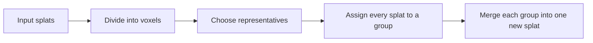

# Keeping the Scene with Fewer Gaussian Splats

This algorithm reduces a large collection of Gaussian splats to a smaller one while trying to preserve the scene's shapes, colors, and visual coverage.

It divides space into small regions, chooses splats that represent different features in each region, assigns every input splat to a representative, and combines each group into a new splat. **Representatives organize the groups; the whole group determines the final output.**

This guide focuses on the algorithm itself. Keep one example in mind: a thin red pole against a white wall. We want fewer splats while keeping the wall continuous and the pole recognizable.

## 1. What Does a Gaussian Splat Represent?

Imagine a small, colored, ellipsoid-shaped brushstroke in space, with edges that gradually fade away. It has several important properties:

- **Position:** where the brushstroke sits.
- **Size and orientation:** whether it is round, flat, or stretched in a particular direction.
- **Opacity:** how strongly it obscures what is behind it.
- **Color information:** its base color and how its color changes with the viewing direction.

Many overlapping brushstrokes can depict walls, leaves, railings, and other structures. Simplification needs to reduce their number while limiting holes, blurring, and color bleeding.

## 2. Set a Target, Then Reduce in Passes

The algorithm first removes invalid data and splats below the chosen opacity threshold. It determines the target from the remaining population. For example, keeping one quarter of one million valid splats gives a final target of 250,000.

A large reduction in one step forces many different features into a small number of outputs. This algorithm works in passes: **each pass targets at least half of its current input count, moving progressively toward the final target.**

Ignoring integer rounding:

- One million to 250,000: first reduce to 500,000, then to 250,000.
- One million to 300,000: first reduce to 500,000, then to 300,000.

Each pass repeats the spatial grouping, representative selection, and merging. The next pass receives the complete splat attributes produced by the previous one.

For very large inputs, the algorithm first splits space repeatedly into a partition tree so that smaller subsets can be processed separately. Each non-empty child region receives at least one output slot. Remaining slots are distributed in proportion to the children's splat counts, without giving a child more slots than its input count. If the combined child outputs still exceed the parent's budget, the parent reduces them again.

These large partitions primarily manage memory. The smaller cells introduced next organize local groups within a reduction pass.

## 3. Divide Space into Cells and Refine Dense Regions

Each pass divides space into small cells called **voxels**. The initial cell count depends on **the target for that pass**, using roughly 24 representative slots per initial cell as a guide. This is a planning guideline rather than a fixed output count for every cell.

A cell containing unusually many splats can be split into smaller cells. Empty cells are omitted. Limits on subdivision depth and total cell count prevent endless splitting.

This gives dense local structures more detailed treatment while allowing sparse regions to use larger cells. The wall and the area around the red pole may therefore end up with different cell sizes.

A single pass follows this sequence:

## 4. How Does the Algorithm Compare Two Splats?

It considers three things:

- **Position:** distance is judged relative to the splats' sizes. The same gap may be small for a large splat but substantial for a tiny one.
- **Shape:** size, proportions, and orientation all matter. Two elongated splats pointing in different directions may represent different structures even when their centers are close.
- **Base color:** a red splat and a white splat still differ even if their positions and shapes are similar.

This gives the red pole a chance to receive a different representative from the white wall, even where they are close together.

Selection and assignment compare only base colors. They do not compare all the color information that varies with viewing direction. That additional information is retained for the final merge.

## 5. Choose an Overall Representative, Then Add Detail

### The first representative balances similarity and visual importance

Every non-empty cell starts with one representative. The algorithm examines candidates to find one that is broadly similar to the cell's contents, while favoring candidates with higher opacity and a larger longest axis.

**The size measure here is the splat's longest principal-axis scale, rather than its surface area or a diagonal length. The aim is to retain as much texture detail as possible.** At equal opacity and longest-axis scale, narrowing the other two axes does not reduce the representative weight. Thin splats along texture lines or edges can therefore compete without needing to become wider in other directions to gain weight. Also, as a splat grows uniformly, its longest-axis weight grows in proportion to length; an area-based weight would grow faster and more strongly favor large splats.

This choice supplies the visual weight for both the first representative and later detail representatives. Whether a particular texture feature survives still depends on color and shape differences, candidate novelty, and the remaining budget. Attribute merging in Section 7 uses a separate weight that includes surface area.

The first representative therefore tends to capture the region's main features, but need not be the splat closest to the cell's center. A cell dominated by the white wall may first choose a splat suited to representing that wall.

### Later representatives capture differences that remain

Each remaining candidate is compared with **the representatives already selected in its own cell**. The algorithm asks how different the candidate still is from its most similar representative.

A larger difference generally makes the candidate more useful. A more visually prominent candidate also has a better chance of receiving a slot. The benefit of increasing difference gradually levels off, so an extreme outlier cannot gain unlimited priority just by being very far away.

In our example, once the wall has a representative, a splat on the red pole may be selected because its color and shape are different. This still depends on the available budget and its visual importance: a very thin or faint pole may be lost.

### How are slots distributed?

Each cell starts with one representative. A portion of the extra slots is then allocated according to the total opacity within each cell. A cell cannot receive more slots than it has input splats.

After cells fill their local quotas, any remaining budget is filled by comparing candidates across all cells. Here, “global” means that cells compete for the remaining slots. A candidate's novelty is still measured against representatives in its own cell.

Selection can stop when the remaining candidates are numerically indistinguishable from existing representatives. When an exact output count is required, additional unselected input splats are placed in separate groups of their own to fill the pass's target.

## 6. Assign Every Splat, Including Across Cell Boundaries

Each selected representative is assigned to itself. Every other splat searches for the most similar representative in its own cell and in neighboring cells that touch it at a face, edge, or corner.

Cell boundaries are only an aid to organizing the algorithm. A real wall should remain continuous as it crosses them. Allowing assignment to neighboring cells helps reduce visible partition boundaries.

The previous step judges whether a candidate deserves another slot using representatives within its own cell. This step determines its final group by also checking neighboring cells. The two searches have different scopes.

Every input splat ends up in one group. Splats that were not selected as representatives still contribute their information to their group's merge.

## 7. How Does a Group Become One New Splat?

During merging, each member receives a weight based on its opacity multiplied by its approximate ellipsoid surface area. This estimates its contribution to coverage.

The algorithm uses different measures for different decisions:

| Stage | Main consideration |
| --- | --- |
| Choosing representatives | Visual importance based on opacity and longest-axis scale, plus features missing from existing representatives |
| Allocating extra slots to cells | Total opacity within each cell |
| Merging group attributes | Each member's opacity and surface area |

### Position: use the group's weighted center

Members with larger contributions have more influence on the new center. The output splat can move away from the original representative's position.

### Shape: account for both individual shapes and the spread of their centers

Imagine two equally sized splats separated horizontally. Their merged splat needs to become wider in that direction to describe their combined extent.

The algorithm combines each member's original shape with its displacement from the new center, then derives the new size and orientation. This process is called **moment matching**: the new splat captures the group's center and overall spread.

### Color: average both base color and variation with viewing direction

All input color coefficients participate in the weighted average. Information about changes with viewing direction is included even though it was not used to form the groups.

Averaging can still lose detail. If the red pole and white wall enter the same group, their colors may mix. The quality of representative selection and assignment therefore directly affects the merged result.

### Opacity: reconstruct it from the group's coverage contribution

The algorithm adds the members' coverage contributions, then divides by the new splat's surface area to determine its opacity parameter. That parameter can exceed 1 because it combines the coverage strength of several splats.

This preserves an approximate measure of coverage, without guaranteeing an identical image from every viewpoint. If a group contains only one member, or its total merge weight is invalid or too small, the complete attributes of its first input member are retained.

## 8. Why Add Display Compensation?

After simplification, coverage can still look insufficient even when centers and overall shapes are reasonable. The algorithm description includes two separate display adjustments.

### Enlarge splats where needed

Splats whose merged opacity parameter exceeds 1 can be enlarged according to that parameter. The two axes other than the longest use the same growth factor. Growth along the longest axis is reduced according to the splat's shape, limiting further stretching of elongated structures.

The strength of this display adjustment is configurable. At zero strength, no enlargement is applied.

### Give stronger coverage a flatter, wider opacity profile

An ordinary Gaussian fades gradually away from its center. When identical Gaussian profiles overlap, the center becomes increasingly opaque and the surrounding region becomes more visible.

The special opacity curve expresses this effect: greater coverage strength produces a flatter center and a wider visible footprint, while opacity at any individual pixel stays at or below 1.

When using this display model, retained size enlargement is accounted for first. An approximate measure of area growth reduces the display opacity parameter before deciding whether to use the special curve. This compensation does not strictly conserve projected area or accumulated pixel opacity for every viewpoint.

**Display adjustments are excluded from the next simplification pass.** Later passes use the original merged attributes, preventing display enlargement from accumulating repeatedly.

For complete formulas and technical details, see the [algorithm specification](./Splat-Simplify.md).
