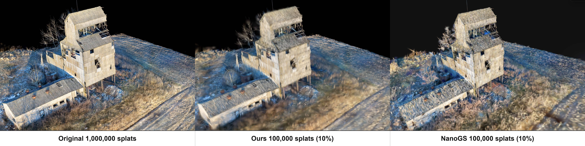

# Voxel-Based Gaussian Splat Simplification

This document describes a voxel-based Gaussian splat simplification algorithm in detail. It first partitions the input splats into adaptive voxels, selects visually representative input splats, assigns every input splat to a local representative, and finally synthesizes new splats through weighted moment matching. Section 10 describes optional display coverage scaling. Section 11 separately describes the special opacity profile used when the display opacity exceeds 1.

The data flow for a single reduction pass is:


<div align="center">
  
</div>

## Hierarchical and Iterative Reduction

The target count is determined after invalid splats and splats below the opacity threshold have been removed. For large inputs, a KD partition tree divides the data into subsets that fit within the memory budget. Target budgets are allocated recursively: each non-empty child first receives one slot, and the remaining slots are distributed in proportion to the populations of children with remaining capacity, using integer rounding and never exceeding a child's input count. If a parent's budget is smaller than its number of non-empty children, each child still receives one slot, so their combined budgets temporarily exceed the parent's budget. Leaf subsets are simplified independently. A parent performs another reduction only when its combined child outputs exceed its allocated budget.

Reduction proceeds iteratively. For a subset with current count $N_k$ and assigned final target $T_{final}$, each pass uses the intermediate target:

```math
T_k=\max\left(T_{final},\left\lceil\frac{N_k}{2}\right\rceil\right).
```

The merged splats become the next pass's complete input, retaining all attributes and excluding the optional display coverage adjustment. Passes continue until the count is no greater than $T_{final}$.

An optional exact-count constraint requires each pass to produce exactly $T_k$ splats. If representative selection stops early because candidates are fully covered, additional input splats are promoted to singleton representatives after assignment until the target is reached. Without this constraint, fully covered duplicates may reduce the output count below the pass target. With the constraint and ignoring integer rounding, a 25% target requires two 50% passes, while a 30% target uses a 50% pass followed by a 60% pass.

## 1. Inputs, Outputs, and Notation

Sections 1–9 describe a single reduction pass. Let $N$ be its input splat count and $T$ its requested upper bound on the output count. In the iterative process above, these correspond to $N_k$ and $T_k$, respectively; $T$ in these sections is the current pass target, not $T_{final}$. For an input splat $i$, let:

- $\boldsymbol\mu_i\in\mathbb R^3$: position;
- $\boldsymbol\ell_i\in\mathbb R^3$: log scale;
- $\boldsymbol s_i=\exp(\boldsymbol\ell_i)$: the three linear scales;
- $\boldsymbol q_i$: quaternion;
- $\boldsymbol\Sigma_i$: the 3D covariance reconstructed from the scale and quaternion;
- $\alpha_i$: linear opacity;
- $\boldsymbol h_i$: the full vector of SH coefficients;
- $\boldsymbol c_i$: DC-derived RGB used only for simplification decisions.

Before covariance construction, $\boldsymbol q_i$ is normalized; a quaternion with squared length below $10^{-20}$ falls back to the identity rotation. After converting the normalized quaternion to rotation matrix $\boldsymbol R_i$, the covariance is:

```math
\boldsymbol\Sigma_i
=
\boldsymbol R_i
\mathrm{diag}(s_{ix}^2,s_{iy}^2,s_{iz}^2)
\boldsymbol R_i^T.
```

The RGB vector used for similarity is constructed only from the three SH DC coefficients and clamped component-wise:

```math
\boldsymbol c_i
=
\mathrm{clamp}_{[0,1]}
\left(0.5+0.15\,\boldsymbol h_i^{DC}\right).
```

All higher-order SH coefficients are excluded from representative selection and assignment, but they are retained and averaged using merge weights during the final merge.

Let the representative set be:

```math
\mathcal R=\{r_1,\ldots,r_M\},
\qquad
M\le T,
```

and let the assignment function be:

```math
a:\{1,\ldots,N\}\rightarrow\{1,\ldots,M\}.
```

Each representative induces a cluster:

```math
C_k=\{i\mid a(i)=k\}.
```

The algorithm synthesizes one output splat for each $C_k$. Without the exact-count constraint, the output count $M$ may be smaller than $T$ when some candidates are fully covered by an existing representative. A candidate is considered fully covered when its maximum log similarity to the representatives in its voxel evaluates to 0 at the chosen numerical precision. This most commonly occurs for exact or numerically near-identical duplicates.

## 2. Scale Measures and Weights

### 2.1 3σ Blended Radius

The diagonal of the covariance matrix in the cloud coordinate system gives the AABB half-extents of the rotated 3σ ellipsoid:

```math
e_{ix}=3\sqrt{(\Sigma_i)_{xx}},\qquad
e_{iy}=3\sqrt{(\Sigma_i)_{yy}},\qquad
e_{iz}=3\sqrt{(\Sigma_i)_{zz}}.
```

The volume-equivalent radius and RMS radius are:

```math
r_{v,i}=\sqrt[3]{e_{ix}e_{iy}e_{iz}},
\qquad
r_{rms,i}=\sqrt{\frac{e_{ix}^2+e_{iy}^2+e_{iz}^2}{3}}.
```

The final blended radius is:

```math
\rho_i
=
r_{v,i}\left(\frac{r_{rms,i}}{r_{v,i}}\right)^{0.5}
=
\sqrt{r_{v,i}r_{rms,i}}.
```

It is used primarily for deterministic tie-breaking. Compared with the maximum-axis length, it introduces a milder bias toward elongated splats.

### 2.2 Three Distinct Weighting Schemes

The algorithm uses three distinct weighting schemes, each serving a different role.

| Stage                    | Weight                                         | Purpose                                                                         |
| ------------------------ | ---------------------------------------------- | ------------------------------------------------------------------------------- |
| Representative selection | $w_i^{rep}=\alpha_i\max(s_{ix},s_{iy},s_{iz})$ | Favor splats with high opacity and a large longest-axis scale as representatives |
| Voxel allocation         | $W_g^{alloc}=\sum_{i\in g}\alpha_i$            | Allocate additional representative budget to regions with greater total opacity |
| Final merge              | $w_i^{merge}=\alpha_i A(\boldsymbol s_i)$      | Aggregate position, shape, and SH using opacity × ellipsoid area                |

Representative selection uses the longest principal-axis scale rather than surface area or diagonal length, aiming to preserve texture detail and thin structures. At fixed opacity and longest-axis scale, narrowing the other two axes does not reduce this weight. Surface area is used separately for merging.

## 3. Adaptive Voxel Grouping

### 3.1 Initial Voxel Budget

Let the current pass's output budget be $T$. The algorithm targets approximately 24 representatives per initial voxel and computes a separate voxel budget:

```math
V
=
\mathrm{clamp}
\left(\left\lfloor\frac{T}{24}\right\rfloor,1,N\right).
```

$T$ controls the upper bound on the current pass's output count, whereas $V$ controls only the density of the initial spatial grouping.

### 3.2 Grid Dimensions Along Each Axis

Let the bounds extents be $b_x,b_y,b_z$, with $b_{max}=\max(b_x,b_y,b_z)$. The initial dimension along each axis approximately satisfies:

```math
d_a
\propto
V^{1/3}\frac{b_a}{b_{max}}.
```

Positive integers $d_x,d_y,d_z$ are chosen so that their proportions follow this relation and their product is close to $V$. If the number of non-empty voxels exceeds $V$, every dimension is repeatedly multiplied by $0.85$, rounded down, and clamped to at least 1. Reduction continues without a fixed iteration limit until the number of non-empty voxels is no greater than $V$.

Positions are normalized to $[0,0.999999]^3$. Voxels may be constructed directly in the cloud coordinate system or after applying a fixed orthogonal transformation. This transformation changes only the orientation of the spatial grouping; Gaussian similarity is still evaluated in the unprojected cloud coordinates.

### 3.3 Recursive Subdivision of Overfull Voxels

The initial grid may place a highly dense region within a single cell. For $N$ input splats, the subdivision threshold is:

```math
H
=
\max\left(2,\left\lceil8\frac{N}{V}\right\rceil\right).
```

When the occupancy of a voxel exceeds $H$, the voxel is split at the midpoint of each axis into at most eight child voxels. The subdivision is subject to the following constraints:

- the maximum recursion depth is 16;
- the total number of active voxels cannot exceed the current pass target $T$;
- empty octants are not created;
- if all points remain within the same octant, subdivision may continue without increasing the number of voxels.

For each voxel, the local representative set consists of representatives from the voxel itself and all face-, edge-, or corner-touching voxels. Because coarse and fine voxels may coexist after adaptive subdivision, this local voxel neighborhood does not necessarily contain exactly 27 voxels.

## 4. Gaussian + RGB Similarity

Representative selection and assignment use the same similarity measure. For splats $i,j$, define:

```math
\overline{\boldsymbol\Sigma}_{ij}
=
\frac{\boldsymbol\Sigma_i+\boldsymbol\Sigma_j}{2},
\qquad
\Delta\boldsymbol\mu_{ij}
=
\boldsymbol\mu_i-\boldsymbol\mu_j.
```

The Gaussian Bhattacharyya log coefficient is:

```math
\log B_{ij}
=
\frac14\log|\boldsymbol\Sigma_i|
+
\frac14\log|\boldsymbol\Sigma_j|
-
\frac12\log|\overline{\boldsymbol\Sigma}_{ij}|
-
\frac18
\Delta\boldsymbol\mu_{ij}^{T}
\overline{\boldsymbol\Sigma}_{ij}^{-1}
\Delta\boldsymbol\mu_{ij}.
```

It is clamped to be no greater than 0. The color term is:

```math
\log C_{ij}
=
-\|\boldsymbol c_i-\boldsymbol c_j\|_2^2.
```

The total log similarity and its corresponding dissimilarity are:

```math
L_{ij}=\log B_{ij}+\log C_{ij},
```

```math
d_{ij}
=
\begin{cases}
+\infty, & L_{ij}=-\infty,\\
\max(0,-L_{ij}), & \text{otherwise}.
\end{cases}
```

This distance is not merely the Euclidean distance between positions. It jointly encodes:

- whether the two centers are close relative to the Gaussian scales;
- whether the covariance magnitudes and orientations are similar;
- whether the DC colors are similar.

For numerical stability, set the Gaussian log similarity to $-\infty$ if either input covariance determinant is non-positive or non-finite, if the determinant of $\overline{\boldsymbol\Sigma}_{ij}$ is non-positive, or if the resulting coefficient is non-finite. The input covariances are reconstructed from valid scales and normalized quaternions, so these checks primarily guard against invalid or numerically degenerate data; they are not a general full positive-definiteness test.

## 5. First Representative in Each Voxel: Coverage-Biased Weighted-Medoid Score

Each non-empty adaptive voxel first selects one coarse representative. Define:

```math
\widehat w_i
:=
\max(w_i^{rep},\varepsilon_w),
\qquad
\varepsilon_w=10^{-12}.
```

For a candidate $i$ in voxel $g$, the weighted mean dissimilarity is:

```math
M_i
=
\frac{
\sum_{j\in g}\widehat w_jd_{ij}
}{
\sum_{j\in g}\widehat w_j
}.
```

The candidate score divides this weighted-medoid cost by the candidate's own representative weight:

```math
S_i=\frac{M_i}{\widehat w_i}.
```

The first representative is:

```math
r_g^{(1)}
=
\arg\min_{i\in g} S_i.
```

The minimizer is not a conventional weighted medoid, which would minimize $M_i$ alone. The additional division by $\widehat w_i$ deliberately biases the result toward a visually important candidate. It gives the first representative two desirable properties:

- it is close to the overall distribution within the voxel;
- it has a high coverage/importance proxy in terms of opacity × maximum scale.

The first representative is important because all subsequent novelty scores are computed relative to the current representative set. Changing the first representative therefore affects the entire sequence of additional representatives.

## 6. Additional Representative Budget

Let $G$ be the number of adaptive voxels. Each voxel initially receives one representative. The local-fill budget, including these coarse representatives, is:

```math
B_{local}=\min(T,N,24G).
```

Only voxels with remaining capacity participate in the proportional allocation. Define:

```math
\mathcal E=\{g\mid n_g>1\},
\qquad
O_g=\sum_{i\in g}\alpha_i.
```

For $g\in\mathcal E$, the ideal quota of additional representatives is:

```math
E_g^{exact}
=
(B_{local}-G)\frac{O_g}{\sum_{h\in\mathcal E}O_h}.
```

Convert $E_g^{exact}$ into an integer quota $E_g$ satisfying:

```math
0\le E_g\le n_g-1,
\qquad
\sum_{g\in\mathcal E}E_g=B_{local}-G.
```

After the floored quotas are clamped to each voxel's remaining capacity, eligible voxels are sorted by the fractional remainder of $E_g^{exact}$. Repeatedly traverse this fixed order, assigning one additional slot to each voxel that still has capacity, until the local-fill budget is exhausted.

## 7. Detail Representatives: Saturating Novelty × Visual Weight

Let $R_g$ be the current set of representatives selected from voxel $g$:

```math
R_g
=
\{r_k\in\mathcal R\mid r_k\text{ was selected from voxel }g\}.
```

For each unselected candidate $i$ in voxel $g$, first find the most similar representative in $R_g$:

```math
L_i^{nearest}
=
\max_{r\in R_g}L_{ir},
\qquad
d_i
=
\max(0,-L_i^{nearest}).
```

The distance is then mapped to an exponentially saturating novelty score:

```math
\nu(d)
=
1-\exp\left(-\frac d3\right).
```

The candidate priority is:

```math
P_i
=
\nu(d_i)\max(w_i^{rep},10^{-12}).
```

This formulation has the following effects:

- when a candidate is nearly redundant with an existing representative, $\nu\approx0$, so even a high-weight candidate is unlikely to receive another representative slot;
- novelty increases as the difference grows;
- the novelty of an extreme outlier approaches 1 but never exceeds it, preventing unbounded distance from producing unbounded priority;
- among candidates with equal novelty, the splat with higher opacity × maximum scale is preferred.

Selection proceeds in two stages:

1. **Local fill**: Within each voxel, repeatedly select the candidate with the highest priority until the voxel reaches its adaptive quota.
2. **Global completion**: If the total number of representatives is still below $T$, repeatedly select the remaining candidate with the largest $P_i$ across all voxels. Whenever a representative is added, recompute $d_i$ and $P_i$ for the remaining candidates in that voxel relative to the updated representative set.

If a candidate's log similarity to an existing representative in its voxel evaluates to 0, it is considered fully covered and removed from the candidate set. This is why duplicate data can result in $M<T$ without the exact-count constraint.

## 8. Final Assignment

Each representative is assigned to itself. Every remaining splat searches only among representatives in:

- its own adaptive voxel;
- every voxel that touches it by a face, edge, or corner.

The assignment rule is:

```math
a(i)
=
\arg\max_{\substack{1\le k\le M\\r_k\in\mathcal N(g_i)}}L_{i r_k}.
```

Here, $\mathcal N(g_i)$ denotes the set of representatives in the voxel containing splat $i$ and in all of its touching neighbors. The assignment $a(i)$ selects the local representative with the highest combined similarity in Gaussian shape, relative position, and DC color.

Searching adjacent voxels reduces seams introduced by fixed grid boundaries while preserving spatial locality.

If the exact-count constraint is active and $M<T$, promote input splats that are not already representatives in input-index order until $M=T$. Each promoted splat is removed from its assigned cluster and becomes a singleton cluster; all other assignments remain unchanged. The original representative stays in each affected cluster, so no existing cluster becomes empty.

## 9. Cluster Attribute Merging

After assignment, each cluster is defined as:

```math
C_k=\{i\mid a(i)=k\}
```

A new position, scale, quaternion, opacity, and set of SH coefficients are synthesized for each cluster when it contains more than one member and has a finite total merge weight greater than $10^{-12}$. Section 9.6 describes the fallback used otherwise.

### 9.1 Ellipsoid Area Merge Weight

The surface area of an ellipsoid with linear scales is approximated using the Knud Thomsen formula with $p=1.6075$:

```math
A(s_x,s_y,s_z)
=
4\pi
\left(
\frac{
(s_xs_y)^p+(s_xs_z)^p+(s_ys_z)^p
}{3}
\right)^{1/p}.
```

The merge weight of each input splat is:

```math
u_i=w_i^{merge}=\alpha_iA(\boldsymbol s_i).
```

### 9.2 Position

For an output cluster $C$, the total weight and new center are:

```math
U=\sum_{i\in C}u_i,
\qquad
\boldsymbol\mu'
=
\frac1U\sum_{i\in C}u_i\boldsymbol\mu_i.
```

### 9.3 Covariance Moment Matching

The new covariance captures both the spatial extent of each input Gaussian and the dispersion of the cluster members' centers:

```math
\boldsymbol\Sigma'
=
\frac1U
\sum_{i\in C}u_i
\left[
\boldsymbol\Sigma_i
+
(\boldsymbol\mu_i-\boldsymbol\mu')
(\boldsymbol\mu_i-\boldsymbol\mu')^T
\right].
```

This is weighted second-moment matching for a Gaussian mixture. Averaging only the input covariances and omitting the second term would incorrectly merge spatially separated splats into an undersized Gaussian.

Compute the eigendecomposition of $\boldsymbol\Sigma'$:

```math
\boldsymbol\Sigma'
=
\boldsymbol R'
\mathrm{diag}(\lambda_1,\lambda_2,\lambda_3)
\boldsymbol R'^T.
```

For numerical stability, bound every eigenvalue below by $\varepsilon_\lambda=10^{-20}$. The new scale and quaternion are:

```math
s'_a=\sqrt{\max(\lambda_a,\varepsilon_\lambda)},
\qquad
\boldsymbol q'=\mathrm{quat}(\boldsymbol R').
```

### 9.4 SH

Every scalar SH coefficient is merged using the same weights:

```math
\boldsymbol h'
=
\frac1U\sum_{i\in C}u_i\boldsymbol h_i.
```

Although the higher-order SH coefficients do not participate in cluster formation, they are all merged into the output using the same merge weights.

### 9.5 Opacity

The merged opacity is reconstructed as the total input opacity-area measure divided by the surface area of the new ellipsoid:

```math
\alpha'
=
\frac{U}{\max(A(\boldsymbol s'),10^{-30})}.
```

This preserves the $\alpha A$ coverage proxy rather than the average opacity. Positive finite results are not clamped, so the merged opacity may exceed 1. Non-positive or non-finite results fall back to $10^{-6}$.

### 9.6 Singleton and Invalid-Weight Fallback

Moment matching is skipped if a cluster contains at most one member, if its total merge weight $U$ is non-finite, or if $U\le10^{-12}$. In these cases, the complete attributes of the first input assigned to that cluster are preserved directly.

## 10. Display Coverage Boost

Display Coverage Boost is an optional post-merge scale adjustment. It is applied only after simplification and is excluded from the merged attributes used as input to subsequent reduction passes or higher levels of the hierarchy.

For an output splat with opacity $\alpha'>1$, first compute the target growth factor for the non-major axes:

```math
F
=
1+c\left(\sqrt{\min(\alpha',1000)}-1\right),
```

where $c\ge0$ controls the adjustment strength. No growth is applied when $c=0$ or $\alpha'\le1$.

The factor $F$ sets the growth of the two non-major axes. The major-axis growth is reduced according to the axis ratio to limit further elongation.

Let $s_{max}\ge s_{mid}\ge s_{min}>0$ denote the sorted linear scales of the merged Gaussian before adjustment. Define:

```math
r=\frac{s_{mid}}{s_{max}},
\qquad
0<r\le1.
```

The anisotropy measure and normalization are:

```math
a=1-r,
\qquad
w_{rest}=1-ar=1-r+r^2,
\qquad
\delta=\frac{F-1}{w_{rest}}.
```

The major axis uses the smaller growth factor:

```math
f_{max}=1+\delta(1-a)
=1+\frac{(F-1)r}{1-r+r^2},
```

while the other two axes use:

```math
f_{rest}
=
1+\delta(1-ar)
=F.
```

Since $1-r+r^2\ge3/4$ and $r\le1-r+r^2$, these factors satisfy $1\le f_{max}\le F$. Thus the longest axis never grows more than the other two axes.

The growth is applied along the Gaussian's existing principal axes. For each axis $k$, use $f_k=f_{max}$ for the major axis and $f_k=F$ for the other two axes, then update the log scale:

```math
\ell'_k
\leftarrow
\ell'_k+\log f_k.
```

The center, rotation, SH coefficients, and merged opacity remain unchanged by this scale adjustment. When $F=1$, the shape is unchanged. The adjusted scales are used for display; subsequent simplification passes continue to use the original moment-matched scales.

## 11. Special Opacity Profile for Opacity Greater Than 1

### 11.1 From Merged Opacity to Display Opacity

The merge in Section 9.5 can produce $\alpha'>1$ because it preserves the summed opacity-area measure of a cluster. This value represents accumulated coverage strength; the final per-pixel opacity must still lie in $[0,1]$.

If the scale growth in Section 10 is retained, its coverage-area proxy is $F^2$. Compensate the display opacity by this factor:

```math
\beta=\frac{\alpha'}{F^2}.
```

For splats with $\alpha'\le1$, use $F=1$ and $\beta=\alpha'$. With no scale growth, $\beta=\alpha'$ for all splats. The special profile is selected when the resulting $\beta>1$. This display compensation does not change the merged opacity passed to subsequent simplification levels.

### 11.2 Radial Opacity Function

Let $\boldsymbol u\in\mathbb R^2$ be the offset from the projected splat center in normalized principal-axis coordinates, and let:

```math
t=\|\boldsymbol u\|_2^2,
\qquad
g(t)=\exp\left(-\frac t2\right).
```

With full Gaussian falloff, the ordinary profile for $0\le\beta\le1$ is:

```math
p(t)=\beta g(t).
```

For $\beta>1$, use the special profile:

```math
b=\min(\beta,1000),
\qquad
p(t)=1-\left(1-g(t)\right)^b.
```

The cap limits the profile strength for extreme opacity values. The expression describes the radial falloff before finite-support truncation and low-opacity rejection.

For an integer $b$, this formula is the accumulated opacity of $b$ identical overlapping Gaussian profiles: each leaves transmittance $1-g(t)$, and their combined transmittance is $(1-g(t))^b$. The same expression extends continuously to non-integer $b$.

### 11.3 Why the Shape Becomes Flatter and Wider

At $b=1$, the special profile equals the ordinary Gaussian $g(t)$. For $b>1$, its center remains at $p(0)=1$, while its surrounding region becomes more opaque. Near the center:

```math
p(t)\approx1-\left(\frac t2\right)^b.
```

The higher power makes the center flatter. The profile stays smooth instead of forming the hard plateau produced by directly clamping $\beta g(t)$ to 1.

For any opacity threshold $0<\tau<1$, the normalized radius where $p(t)=\tau$ is:

```math
R_\tau
=\sqrt{-2\ln\left(1-(1-\tau)^{1/b}\right)}.
```

This radius increases with $b$, so greater opacity strength produces a wider visible footprint. For example, the half-opacity radius grows from approximately $1.177$ at $b=1$ to $1.917$ at $b=4$.

This special shape is a change to the opacity falloff over the projected ellipse. It does not itself change the Gaussian's center, covariance, or principal-axis orientation. The geometric scale growth in Section 10 and the opacity-profile change here are separate operations.
